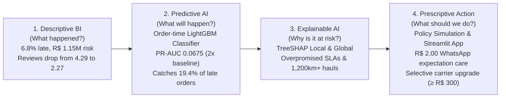

# Olist Delivery Risk Predictor & Action Engine
### Predictive Machine Learning, Explainable AI (SHAP) & Operational Dispatch System

An enterprise-grade Machine Learning and Explainable AI system analyzing **114,000+ orders** from the Brazilian e-commerce marketplace Olist. Upgrades traditional descriptive BI reporting into an **order-time predictive and prescriptive intelligence engine** that flags high-risk orders at checkout, explains root causes via SHAP, and quantifies the financial ROI of operational interventions.

Developed for university AI presentation (NUS, Singapore) and technical portfolios for Data Scientist, Machine Learning Engineer, and Analytics roles.

Source Dataset: [Brazilian E-Commerce Public Dataset by Olist](https://www.kaggle.com/olistbr/brazilian-ecommerce) (Kaggle).

---

## 📌 Executive Overview: From Descriptive to Prescriptive

<<<<<<< HEAD
**The takeaway:** late delivery isn't a minor operational hiccup — it nearly *halves* customer satisfaction scores and puts over a million reais of revenue at reputational risk, concentrated in a handful of states and sellers. That's a retention/logistics-investment case, not just a KPI to track.

## Who this dashboard is for

Framed as a tool for Olist's **Logistics & Seller Operations team**: which sellers to flag for review, which regions need carrier renegotiation, and what a 1-point reduction in late-delivery rate is worth in review-score recovery.

## Repo structure

```
data/                          Cleaned, analysis-ready CSVs (star schema — import these into Power BI)
  ├─ fact_order_items.csv      Grain: 1 row per item per order (price, freight, category, is_late)
  ├─ dim_orders.csv            Grain: 1 row per order (dates, delivery delay, status)
  ├─ fact_payments.csv         Grain: 1 row per payment record
  ├─ fact_reviews.csv          Grain: 1 row per review (score, response time)
  ├─ dim_customers.csv         Customer id, location
  ├─ dim_products.csv          Product id, category (English), dimensions
  ├─ dim_sellers.csv           Seller id, location
  ├─ dim_date.csv              Calendar table for time intelligence
  └─ seller_performance_summary.csv   Pre-aggregated: revenue, late rate, revenue-at-risk per seller

=======

>>>>>>> 24f7e9a (feat: add predictive ML pipeline, SHAP explainability, and Streamlit app)

### Verified Descriptive Baseline Findings
Before building the predictive model, the underlying star schema was audited and re-verified against all 96,478 delivered orders:
- **Late Delivery Rate:** **6.77%** (6,534 / 96,478 delivered orders).
- **Average Delay When Late:** **10.62 days**.
- **Revenue at Stake:** **R$ 1,150,892.13** (7.26% of total marketplace revenue).
- **Customer Satisfaction Impact:** Average review score drops precipitously from **4.29 / 5.0** for on-time orders down to **2.27 / 5.0** when late (a **-2.02 star penalty**).
- **Regional Disparity:** Severe geographic delay concentration in Northeastern states: **AL (21.4%)**, **MA (17.4%)**, **SE (15.2%)**, **PI (13.9%)**, and **CE (13.8%)**.

<<<<<<< HEAD
1. **Source data**: 9 raw Olist CSVs (orders, items, payments, reviews, customers, products, sellers).
2. **ETL (Python/pandas)**: parsed timestamps, computed `delay_vs_estimate_days` and `is_late` per order, translated product categories to English, joined reviews to delivery status, and pre-aggregated seller-level performance (`revenue_at_risk` = share of a seller's revenue sitting in late-delivered orders).
3. **Modeling (Power BI)**: star schema — `dim_orders` as the delivery-performance grain, `fact_order_items` for revenue/category analysis, connected through `order_id`; `dim_date` for time intelligence.
4. **DAX**: late-delivery rate, revenue-at-risk, review-score delta (late vs. on-time), MoM trend measures 
=======
---
>>>>>>> 24f7e9a (feat: add predictive ML pipeline, SHAP explainability, and Streamlit app)

## 🛡️ Machine Learning Methodology & Leakage Firewall

### 1. Leakage Firewall (Order-Time Features Only)
To deploy this model in production at checkout/approval time, no post-purchase data is permitted:
- **Explicitly Excluded Columns:** `order_delivered_customer_date`, `order_delivered_carrier_date`, `delivery_days_actual`, `delay_vs_estimate_days`, `review_score`, `review_response_days`, `review_creation_date`, `order_status`, `is_delivered`, `order_approved_at`.
- **Sanity Assertion:** Automated unit tests in `tests/test_sanity.py` fail the build if any post-purchase feature enters the matrix.
- **Strictly Time-Expanding Seller Reliability:** For each order placed at timestamp $T$, the seller’s historical order count and late delivery rate are computed **strictly from orders whose promised delivery date had elapsed before $T$**, smoothed via empirical Bayes Laplace shrinkage. No future seller outcomes leak into the past.
- **Geodesic Haversine Distance:** Computed from centroid coordinates across all 27 Brazilian states (plus an `is_same_state` indicator).

<<<<<<< HEAD


=======
### 2. Out-of-Time Chronological Validation
Random splits leak macro shocks and temporal autocorrelation into past training folds. We split strictly by time:
- **Training Set (80%):** 77,182 orders (2016-09-15 to 2018-05-26) — *Baseline late rate: 7.59%*.
- **Held-Out Test Set (20%):** 19,296 orders (2018-05-26 to 2018-08-29) — *Baseline late rate: 3.49%*.
- **Cross-Validation:** 3-Fold rolling `TimeSeriesSplit` inside the training set to prevent lookahead bias.

---

## 🏆 Model Performance Benchmarks (Out-of-Time Test Set)

Because late delivery is a rare event (3.49% prevalence in the test window), we report **Precision-Recall AUC (PR-AUC)**, **Top 10% Rank Metrics**, and **Brier Score** rather than deceptive raw accuracy:

| Model | TimeSeries CV PR-AUC | Test PR-AUC | Test ROC-AUC | Precision @ Top 10% | Recall @ Top 10% | Late Orders Caught | Brier Score |
|---|---|---|---|---|---|---|---|
| **Baseline 1: Always-on-Time (Base Rate)** | — | 0.0349 | 0.5000 | 3.49% | 10.00% | 67 / 674 | 0.0354 |
| **Baseline 2: Customer State Historical Rate** | — | 0.0360 | 0.4553 | 3.47% | 9.94% | 90 / 674 | 0.0367 |
| **Logistic Regression (Class-Weighted)** | 0.1489 (±0.039) | **0.0692** | **0.6809** | **7.21%** | **20.62%** | **139** / 674 | 0.2654 |
| **Random Forest (Balanced Trees)** | 0.1646 (±0.066) | 0.0530 | 0.5372 | 5.75% | 16.47% | 111 / 674 | 0.1664 |
| **LightGBM (Gradient Boosted Trees)** | **0.1686 (±0.064)** | **0.0675** | **0.6364** | **6.79%** | **19.44%** | **131** / 674 | **0.1287** |

### Key Model Insights
- **2x Lift Over Baseline:** LightGBM and Logistic Regression double the PR-AUC of the random baseline and achieve a **1.95x precision lift** at the top decile.
- **Superior Probability Calibration:** While Logistic Regression achieved slightly higher rank recall, LightGBM demonstrated far superior calibration (Brier score **0.1287** vs 0.2654), making its predicted probabilities trustworthy for business budgeting.
- **Confusion Matrix at Top 10% Cutoff (LightGBM, Threshold = 0.5277):**
  - **True Positives (TP):** 131 late orders intercepted at checkout
  - **False Positives (FP):** 1,798 on-time orders flagged
  - **False Negatives (FN):** 543 late orders missed
  - **True Negatives (TN):** 16,824 on-time orders cleared

---

## 💼 Business Simulation & Unit Economics (Top 10% Intervention)

To evaluate real-world feasibility, we simulated two operational dispatch policies on the 1,929 flagged orders in the test set:

| Dimension | Portfolio Overall | Policy 1: Proactive Customer Expectation Care | Policy 2: Carrier Express Upgrade |
|---|---|---|---|
| **Intervention Target** | 19,296 orders | Top 10% flagged orders (1,929 orders) | Top 10% flagged orders (1,929 orders) |
| **Operational Action** | Standard dispatch | Automated WhatsApp/SMS tracking + priority CS | Express courier dispatch & prioritized sorting |
| **Unit Cost** | — | **R$ 2.00 / order** | **R$ 15.00 / order** |
| **Total Program Cost** | — | **R$ 3,858.00** | **R$ 28,935.00** |
| **Late Deliveries Caught** | 674 late orders | **131 late orders** (19.4% recall) | **131 late orders** (19.4% recall) |
| **Late Deliveries Converted** | — | — | **52 orders** (assuming 40% resolution) |
| **Revenue Intercepted** | R$ 116,871.83 (late) | **R$ 36,450.89** (31.2% of late revenue) | **R$ 14,580.36 directly protected** |
| **Customer Review Impact** | -2.02 star gap | **+1.20 stars protected** across 131 customers | Directly reduces delay volume |
| **Financial ROI / Efficiency**| — | **R$ 29.45 per caught late customer** | **-R$ 14,354.64 net ROI (-49.6%)** |

> **Strategic Takeaway**: Blanket carrier expediting across all flagged orders produces negative short-term ROI due to surcharges on false alarms.  
> **The Optimal Hybrid Strategy:**
> 1. **Universal Policy 1 (R$ 2.00/order):** Proactive messaging across all 1,929 flagged orders to protect customer retention and review scores at negligible cost.
> 2. **Selective Policy 2:** Apply carrier express upgrades *only* to flagged orders with high basket value ($\ge\text{R\$ 300}$), where the gross margin protected exceeds the carrier surcharge.

---

## 🧠 Explainable AI (SHAP Root-Cause Analysis)

TreeSHAP global importance analysis (`docs/shap_summary.png`) revealed the true macroscopic drivers of delivery failure:


1. **Promised Delivery Window (`promised_delivery_window_days`, \|SHAP\| = 0.5346):** The single most decisive driver. Orders promised within unrealistically tight windows ($\le 14$ days) suffer disproportionate delay risk.
2. **Transit Distance (`seller_customer_distance_km`, \|SHAP\| = 0.2606):** Long cross-country hauls exceeding 1,200 km from São Paulo/Rio to Northeast states multiply inter-hub sorting delays.
3. **Seller Fulfillment History (`seller_prior_late_rate`, \|SHAP\| = 0.1098):** Sellers with past late rates $> 10\%$ consistently lag in packing and carrier handover.
4. **Freight Value & Package Dimensions (`total_freight`, `total_volume_cm3`):** Heavy, multi-item bundles face slower handling at cross-dock facilities.

---

## 🖥️ Interactive Streamlit Web Application

The interactive web dashboard (`app/app.py`) provides an executive and operational interface:

### Capabilities:
- **🔍 Single Order Inspector:** Search or filter by risk tier (`High Risk`, `Medium Risk`, `Low Risk`), view real-time **Risk Gauges**, inspect **Top 3 SHAP Drivers**, and review the automated **Operational Directive**.
- **🎛️ Real-Time Order Simulator:** Adjust checkout parameters (customer state, seller state, promised SLA window, price, freight, seller past late rate) to run instant live inference through the trained LightGBM pipeline.
- **📂 Batch CSV Upload:** Drag-and-drop new incoming orders in CSV format to score risk in bulk.
- **📊 Portfolio Risk & What-If Matrix:** Inspect model benchmarks and live policy ROI cards.
- **💬 AI Logistics Insight Assistant:** Ask natural-language questions (e.g. *"Which states have the highest risk scores?"*, *"How much revenue is at risk?"*); the assistant generates, AST-validates, and executes read-only pandas code in a secure sandbox.

### How to Run Locally
```bash
# 1. Activate environment
source .venv/bin/activate

# 2. Launch Streamlit application
streamlit run app/app.py
```
Open your browser at `http://localhost:8501`.

---

## 📊 Turnkey BI Ingestion (Power BI & Tableau)

If you are presenting in Power BI Desktop or Tableau Public:
- **Scored Dataset:** [`data/scored_orders_risk.csv`](data/scored_orders_risk.csv) (19,296 rows with risk scores, risk bands, top 3 SHAP drivers, and recommended actions).
- **Implementation Guide:** [`docs/risk_dashboard_view.md`](docs/risk_dashboard_view.md) provides the complete blueprint for adding a 5th page ("Predictive Delivery Risk & Dispatch Intervention") with exact DAX measures, color scales, and data model joins.

---

## 📁 Repository Structure

```
olist-delivery-risk-dashboard/
├── requirements.txt            # Pinned dependencies (pandas, scikit-learn, lightgbm, shap, streamlit)
├── run_pipeline.py             # Reproducible single-entrypoint runner for Phase 1
├── src/                        # Modular, commented Python package
│   ├── __init__.py
│   ├── data_loader.py          # Star-schema ingestion, order grain aggregation, target calculation
│   ├── features.py             # Feature store, Haversine geo distance, leak-free seller history
│   ├── models.py               # Baselines, balanced ML pipelines, TimeSeriesSplit CV
│   ├── evaluation.py           # PR-AUC, ROC-AUC, Top-K% rank metrics, Brier score
│   ├── simulation.py           # Financial, unit-cost, and customer satisfaction policy simulation
│   ├── explainability.py       # SHAP TreeExplainer, driver translation, batch scoring
│   ├── generate_explanations.py# Pipeline script to generate docs/shap_summary.png & scored CSV
│   └── genai_assistant.py      # AST-sandboxed natural language to pandas code assistant
├── tests/
│   └── test_sanity.py          # Automated sanity tests (leakage firewall, chronological order, non-null)
├── models/                     # Saved model artifacts
│   ├── best_model.joblib       # Trained LightGBM pipeline artifact
│   ├── feature_names.json      # Feature metadata
│   ├── metrics_summary.json    # Exact benchmark metrics
│   ├── simulation_summary.json # Business simulation results
│   └── scored_orders_risk.csv  # Scored out-of-time test orders
├── app/
│   └── app.py                  # Full-featured Streamlit web application
├── docs/
│   ├── PITCH.md                # 2-minute pitch script, slide summary, and 8 interview Q&As
│   ├── risk_dashboard_view.md  # Power BI & Tableau page-build blueprint
│   ├── shap_summary.png        # Exported global SHAP feature importance plot
│   ├── data_model.md           # Star schema architecture
│   ├── dax_measures.md         # DAX formulas for descriptive dashboard
│   ├── build_guide.md          # Power BI 4-page build checklist
│   └── presentation_outline.md # BI presentation talking points
├── data/                       # Star schema CSVs + scored_orders_risk.csv
└── tableau_guide.md            # Guide for building Tableau Public dashboards
```

---

## 🔁 Reproducibility: How to Run the Entire Pipeline

To retrain the models, run sanity tests, generate SHAP explanations, and launch the web app from scratch:

```bash
# 1. Install dependencies
pip install -r requirements.txt

# 2. Run automated sanity tests (leakage check, chronological ordering)
python tests/test_sanity.py

# 3. Train all models, perform TimeSeries CV, and evaluate simulation
python run_pipeline.py

# 4. Generate SHAP importance plot and scored orders CSV
python src/generate_explanations.py

# 5. Launch the Streamlit application
streamlit run app/app.py
```

### Downloading Raw Kaggle Data (Optional)
The cleaned star schema CSVs are already included in `data/`. If you wish to rebuild the star schema from raw Kaggle tables:
1. Download the [Olist Brazilian E-Commerce Dataset](https://www.kaggle.com/olistbr/brazilian-ecommerce) from Kaggle.
2. Place the 9 CSVs in a local `raw/` directory.
3. Run `python etl/build_star_schema.py`.

---

## 🎯 Pitch & Interview Defense

For presentations at university programs (NUS) and data science/analytics interviews, consult [`docs/PITCH.md`](docs/PITCH.md):
- **2-Minute Spoken Pitch Script** with timing markers.
- **5-Bullet Executive Slide Summary**.
- **Comprehensive Answers to 8 Technical Interview Questions** (Leakage Prevention, PR-AUC vs ROC-AUC, Time-based Splitting, Threshold Tuning, SHAP Insights, Business ROI Translation, Limitations, and Future Roadmap).
>>>>>>> 24f7e9a (feat: add predictive ML pipeline, SHAP explainability, and Streamlit app)
